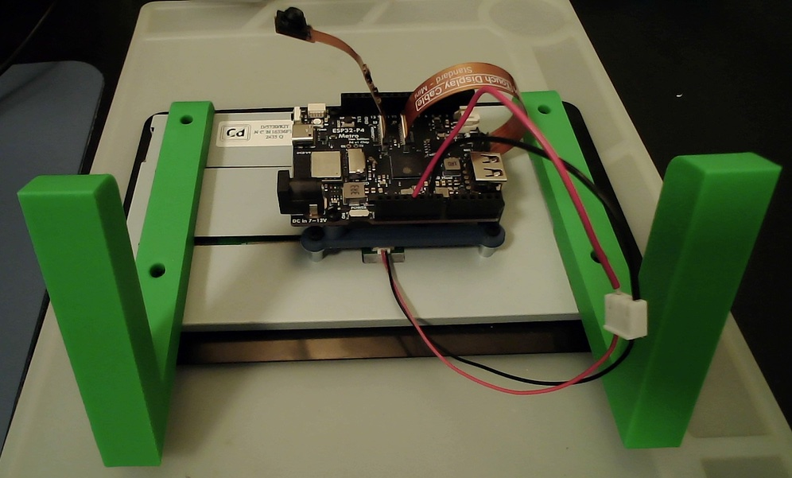

# Touch Display 2 to Metro ESP32-P4 adapter

A printed skeleton frame that mounts an [Adafruit Metro ESP32-P4](https://www.adafruit.com/product/6536) on the back of a [Raspberry Pi Touch Display 2](https://www.raspberrypi.com/products/touch-display-2/) (7"). It screws into the display's Pi standoffs and holds the Metro on M2.5 heat set inserts.

Video: [mikeysklar.github.io/touch2-metro-p4-adapter](https://mikeysklar.github.io/touch2-metro-p4-adapter/)

## Downloads

| File | Use |
|---|---|
| [touch2_metro_adapter.3mf](downloads/touch2_metro_adapter.3mf) | Print |
| [touch2_metro_adapter.FCStd](downloads/touch2_metro_adapter.FCStd) | FreeCAD |
| [touch2_metro_adapter.step](downloads/touch2_metro_adapter.step) | Other CAD |
| [build_adapter.py](build_adapter.py) | Parametric source, `freecadcmd build_adapter.py -- --out build` |

## Hardware

| Part | Qty |
|---|---|
| M2.5 heat set insert, 3.5 mm hole, 4 mm long | 4 |
| M2.5 x 5 pan head, Metro to inserts | 4 |
| M2.5 x 6 pan head, frame to display | 4 |

## Print and assemble

1. Print flat with the bosses up. No supports.
2. Press the inserts into the four bosses.
3. Screw the frame onto the display's four Pi standoffs.
4. Screw the Metro onto the inserts. Its USB and DC jack face the display's bottom edge.

The frame is 59 x 68 x 9 mm. The open end of the U sits over the display's DSI connector so the ribbon can come out under the board.

## Sources

- Touch Display 2 dimensions: Raspberry Pi Touch Display 2 product brief, page 4
- Metro hole positions: [Adafruit-Metro-ESP32-P4-Hydra-PCB](https://github.com/adafruit/Adafruit-Metro-ESP32-P4-Hydra-PCB) (Arduino Uno pattern)

## License

[MIT-0](LICENSE)
